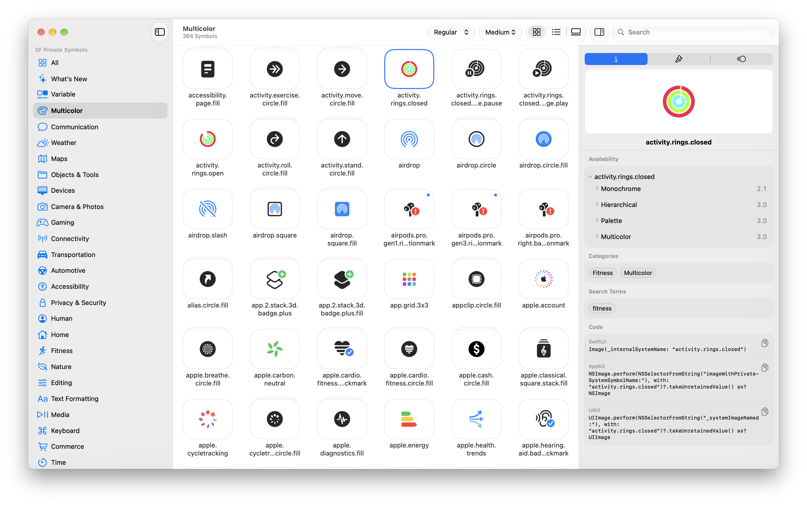

# SF Private Symbols

SF Private Symbols is a Mac app for browsing the SF Symbols that Apple keeps for itself.

Apple's SF Symbols app lists the thousands of public symbols, but macOS also ships over 1,700 private ones,
used throughout Apple's own apps for AirPods, Apple Watch, Apple TV, accessibility features and more. They
live in a system bundle that no app shows you. SF Private Symbols does, in an app that looks and works
like SF Symbols.

**[Visit the project website →](https://leonatan.github.io/SFPrivateSymbols/)**

<picture>
  <source media="(prefers-color-scheme: dark)" srcset="./Supplements/screenshot-dark.png">
  <source media="(prefers-color-scheme: light)" srcset="./Supplements/screenshot.png">
  
</picture>

## Features

- **Browse** every private symbol in grid, list and gallery views, organized into SF Symbols' categories,
  with search by name, alias and search term.
- **Inspect** each symbol: the SF Symbols version and OS releases that introduced it, its aliases,
  categories, search terms, fill and localized variants, and usage restrictions.
- **Preview** any weight and scale in monochrome, hierarchical, palette or multicolor, with gradients,
  variable values and custom colors and backgrounds.
- **Animate** symbols with every SF Symbols effect: bounce, pulse, variable color, scale, wiggle, rotate,
  breathe, replace, draw on and off, and more.
- **Copy** a symbol as SVG or PNG, its name, or ready-to-use SwiftUI, AppKit and UIKit code.
- **Export** symbol templates for designers, or for Xcode asset catalogs.

## Requirements

macOS 26 or later. Open `SFPrivateSymbols.xcodeproj` and build; the app is installed into
`/Applications/SF Private Symbols.app` (see [`CLAUDE.md`](CLAUDE.md)).

SF Symbols, private ones included, are subject to Apple's
license terms, listed on [Apple's SF Symbols page](https://developer.apple.com/sf-symbols/).

## Contributing

How the app was built, including how Apple's SF Symbols app was inspected and what was learned from it, is
documented in [`CLAUDE.md`](CLAUDE.md).
